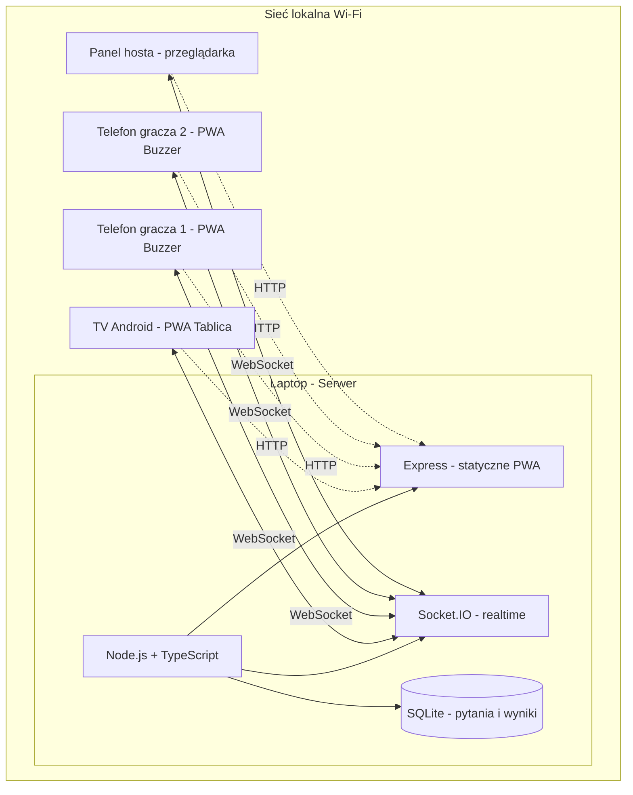
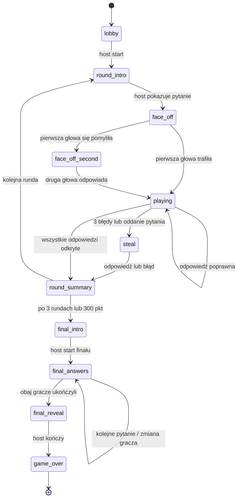
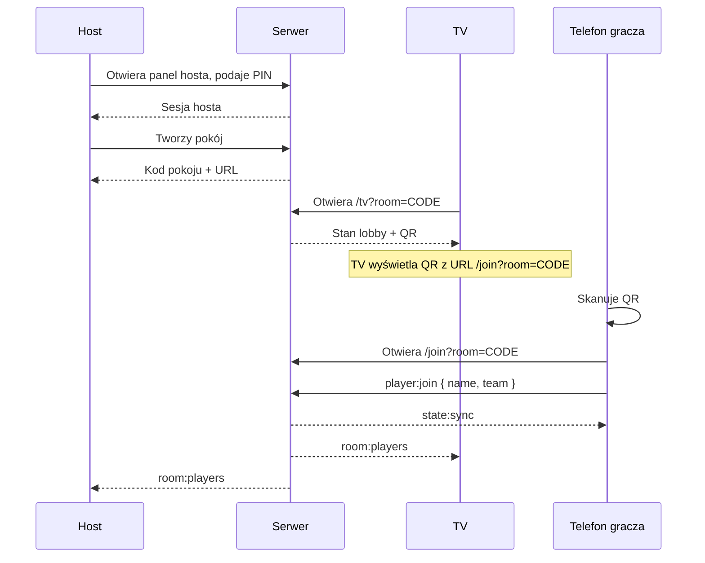
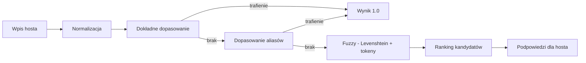

# Familiada LAN — Dokument Architektury

## 1. Cel i zakres

Gra typu Familiada (Family Feud) działająca w sieci lokalnej (LAN), bez dostępu do internetu.

- **Serwer** uruchamiany na laptopie (Node.js + TypeScript).
- **Telefony z Androidem** pełnią rolę buzzerów (PWA w przeglądarce, bez instalacji).
- **TV z Androidem** wyświetla tablicę wyników (PWA w przeglądarce, tryb pełnoekranowy).
- **Host (prowadzący)** steruje grą z panelu w przeglądarce (laptop lub telefon), loguje się PIN-em.
- **Baza pytań** w SQLite, edytowalna przez panel hosta, z seedem z pliku JSON.

### Zakres MVP (potwierdzony)

- 2 drużyny, **3 rundy** pytań (oficjalny regulamin), gra do **300 pkt**, runda finałowa.
- **Face-off głów rodzin** z porównaniem pozycji odpowiedzi na tablicy.
- **Mnożniki punktów:** ×1, ×2, ×2 (po 4. pytaniu ×3).
- **Oddanie pytania** drużynie przeciwnej.
- **Limit czasu 3 s** na odpowiedź (timer w panelu hosta).
- Buzzowanie: gracz naciska przycisk na telefonie → host zatwierdza kto odpowiada.
- Gracz mówi odpowiedź na głos → host wpisuje ją w panelu → serwer fuzzy-matchuje i podpowiada → host zatwierdza/odrzuca.
- Punkty za odkryte odpowiedzi.
- **Finał z 2 graczami:** 5 pytań, limity 15 s / 20 s, próg 200 pkt.
- **Tryb demo:** boty rozgrywają całą grę automatycznie (`/demo`).
- Parowanie: TV wyświetla QR z linkiem do pokoju, gracze skanują i dołączają. Host loguje się PIN-em.
- Edytor pytań w panelu hosta.

### Poza zakresem MVP

- Rozgrywki poza LAN (tunel, publiczny URL).
- Natywne aplikacje Android.
- Wiele pokoi równolegle (architektura przewiduje, ale MVP = 1 pokój).
- Rozpoznawanie mowy (gracz mówi, host wpisuje ręcznie).

---

## 2. Architektura wysokopoziomowa



### Komponenty

| Komponent | Technologia | Rola |
|---|---|---|
| Serwer aplikacji | Node.js 20+, TypeScript, Express | Serwuje PWA, REST API dla edytora pytań |
| Warstwa realtime | Socket.IO | Synchronizacja stanu gry, buzzery, tablica |
| Baza danych | SQLite (better-sqlite3) | Pytania, odpowiedzi, historia gier |
| Klient TV | PWA (HTML/CSS/JS lub React) | Tablica wyników, QR, animacje |
| Klient telefon | PWA | Buzzer, status gracza |
| Klient hosta | PWA | Sterowanie grą, edytor pytań |

### Zasady projektowe

1. **Serwer jest jedynym źródłem prawdy** — cały stan gry żyje na serwerze; klienty są bezstanowe i renderują otrzymany stan.
2. **Stan gry w pamięci + snapshot do SQLite** — szybkość realtime, trwałość po restarcie.
3. **Autorytatywne buzzowanie** — serwer rozstrzyga kolejność zgłoszeń (timestamp serwera), nie klient.
4. **Idempotentne eventy** — każda akcja hosta ma `actionId`, aby uniknąć podwójnego naliczenia punktów.
5. **Bez internetu** — wszystkie zasoby (fonty, ikony, biblioteki) serwowane lokalnie; brak CDN.

---

## 3. Model danych

### 3.1 Schemat SQLite

```sql
-- Pytania
CREATE TABLE questions (
  id            INTEGER PRIMARY KEY AUTOINCREMENT,
  text          TEXT NOT NULL,
  category      TEXT,
  round_type    TEXT NOT NULL DEFAULT 'normal', -- normal | final
  difficulty    INTEGER DEFAULT 1,
  is_active     INTEGER NOT NULL DEFAULT 1,
  created_at    TEXT NOT NULL DEFAULT (datetime('now')),
  updated_at    TEXT NOT NULL DEFAULT (datetime('now'))
);

-- Odpowiedzi przypisane do pytania (ranking = pozycja na tablicy)
CREATE TABLE answers (
  id            INTEGER PRIMARY KEY AUTOINCREMENT,
  question_id   INTEGER NOT NULL REFERENCES questions(id) ON DELETE CASCADE,
  text          TEXT NOT NULL,
  points        INTEGER NOT NULL,
  rank          INTEGER NOT NULL,               -- 1..N pozycja na tablicy
  aliases       TEXT NOT NULL DEFAULT '[]',     -- JSON array stringów
  UNIQUE (question_id, rank)
);

-- Historia rozgrywek
CREATE TABLE games (
  id            INTEGER PRIMARY KEY AUTOINCREMENT,
  room_code     TEXT NOT NULL,
  started_at    TEXT NOT NULL DEFAULT (datetime('now')),
  finished_at   TEXT,
  team_a_name   TEXT NOT NULL,
  team_b_name   TEXT NOT NULL,
  team_a_score  INTEGER NOT NULL DEFAULT 0,
  team_b_score  INTEGER NOT NULL DEFAULT 0,
  state_json    TEXT NOT NULL                   -- pełny snapshot stanu
);

-- Log zdarzeń (audyt, debug, replay)
CREATE TABLE game_events (
  id            INTEGER PRIMARY KEY AUTOINCREMENT,
  game_id       INTEGER NOT NULL REFERENCES games(id) ON DELETE CASCADE,
  seq           INTEGER NOT NULL,
  type          TEXT NOT NULL,
  payload_json  TEXT NOT NULL,
  created_at    TEXT NOT NULL DEFAULT (datetime('now'))
);
```

### 3.2 Format seed JSON

```json
{
  "questions": [
    {
      "text": "Wymień rzecz, którą zabierasz na plażę",
      "category": "wakacje",
      "roundType": "normal",
      "answers": [
        { "text": "ręcznik", "points": 32, "rank": 1, "aliases": ["recznik", "koc"] },
        { "text": "krem do opalania", "points": 24, "rank": 2, "aliases": ["krem", "filtry"] },
        { "text": "okulary przeciwsłoneczne", "points": 18, "rank": 3, "aliases": ["okulary"] }
      ]
    }
  ]
}
```

### 3.3 Stan gry w pamięci (TypeScript)

```ts
type Phase =
  | 'lobby'
  | 'round_intro'
  | 'face_off'        // pojedynek o prawo do odpowiedzi
  | 'playing'         // drużyna odpowiada
  | 'steal'           // przejęcie przez drugą drużynę
  | 'round_summary'
  | 'final_intro'
  | 'final_answers'   // 5 pytań finałowych
  | 'final_reveal'
  | 'game_over';

interface GameState {
  roomCode: string;
  phase: Phase;
  roundIndex: number;          // 0..4
  activeTeam: 'A' | 'B' | null;
  teams: {
    A: TeamState;
    B: TeamState;
  };
  currentQuestion: QuestionState | null;
  strikes: number;             // 0..3
  buzzQueue: BuzzEntry[];      // kolejka zgłoszeń
  answeringPlayerId: string | null;
  finalRound: FinalRoundState | null;
  lastActionId: string | null;
  version: number;             // monotoniczny licznik stanu
}

interface TeamState {
  name: string;
  score: number;
  players: PlayerState[];
  roundPoints: number;
}

interface PlayerState {
  id: string;
  name: string;
  team: 'A' | 'B';
  connected: boolean;
  isCaptain: boolean;
}

interface QuestionState {
  questionId: number;
  text: string;
  answers: AnswerState[];      // z flagą revealed
  revealedCount: number;
  totalPoints: number;
}

interface AnswerState {
  answerId: number;
  text: string;
  points: number;
  rank: number;
  revealed: boolean;
}

interface BuzzEntry {
  playerId: string;
  team: 'A' | 'B';
  serverTimestamp: number;
}

interface FinalRoundState {
  team: 'A' | 'B';
  questions: QuestionState[];  // 5 pytań
  currentIndex: number;
  answersGiven: string[];      // odpowiedzi wpisane przez hosta
  totalPoints: number;
}
```

---

## 3.4 Tryb demo

Pokój demo (`POST /api/demo`, `GET /demo`) tworzy grę z botami, które rozgrywają całą partię automatycznie.

- **Boty:** 6 graczy (3 na drużynę), pierwszy w drużynie to głowa rodziny.
- **Wiedza bota:** `knowledge` 0.85 (głowa) / 0.6 (pozostali) — prawdopodobieństwo trafienia.
- **Sterowanie:** [`src/server/game/demo.ts`](../src/server/game/demo.ts) — `demoStep()` wykonuje jedną akcję zależną od fazy, `startDemo()` uruchamia pętlę z opóźnieniem.
- **Start:** boty ruszają, gdy pierwszy klient (TV/host) podłączy się do pokoju.
- **Broadcast:** `Room.onStateChange` wysyła `state:sync` do wszystkich klientów pokoju.
- **Izolacja:** pokój demo nie wymaga graczy ani PIN-u do obserwacji; host może się podłączyć i obserwować.

---

## 4. Maszyna stanów gry



### Reguły rundy normalnej (oficjalny regulamin)

1. **Face-off głów rodzin** — host pokazuje pytanie. Pierwsza głowa rodziny odpowiada:
   - **Trafienie** → jej drużyna przejmuje pytanie (`playing`).
   - **Błąd** → faza `face_off_second`; druga głowa odpowiada. Trafienie **wyżej na tablicy** (mniejszy rank) przejmuje pytanie, w przeciwnym razie pytanie zostaje przy pierwszej drużynie.
   - Obie pomyłki → pytanie zostaje przy pierwszej drużynie.
2. **Playing** — aktywna drużyna odpowiada. Host wpisuje odpowiedź → fuzzy match → host zatwierdza:
   - **Trafienie** → odpowiedź odkryta, punkty (z mnożnikiem) doliczone do puli rundy.
   - **Błąd** → strike +1. Przy 3 strike'ach → faza `steal`.
3. **Oddanie pytania** — drużyna może zrezygnować i przekazać pulę przeciwnikom (`passQuestion`).
4. **Steal** — druga drużyna ma jedną szansę. Trafienie → przejmuje całą pulę rundy. Błąd → pula wraca do pierwszej drużyny.
5. **Round summary** — pula rundy doliczona do wyniku drużyny, która ją zdobyła.

### Mnożniki punktów

| Runda | Mnożnik |
|---|---|
| 1 | ×1 |
| 2 | ×2 |
| 3 | ×2, a po 4. pytaniu ×3 |

### Warunek zwycięstwa

- Drużyna wygrywa po osiągnięciu **300 punktów** (konfigurowalne `gameTargetPoints`).
- Jeśli po 3 rundach nikt nie osiągnął progu — wygrywa drużyna z wyższym wynikiem.

### Reguły finału

1. Host wybiera drużynę finałową i wskazuje **dwóch graczy**.
2. Pierwszy gracz odpowiada na 5 pytań (limit **15 s** na pytanie, możliwość pominięcia).
3. Drugi gracz odpowiada na te same pytania (limit **20 s**), nie może powtórzyć odpowiedzi pierwszego.
4. Po ukończeniu obu graczy → `final_reveal`: tablica odkrywa odpowiedzi, punkty sumowane.
5. Zwycięstwo przy progu **200 punktów** (konfigurowalne `finalTargetPoints`).

### Punktacja

- Punkty za odpowiedź = wartość `points` z bazy × mnożnik rundy.
- Pula rundy = suma punktów odkrytych odpowiedzi.
- Finał = suma punktów obu graczy ze wszystkich trafionych odpowiedzi.

---

## 5. Kontrakty Socket.IO

### 5.1 Namespace i pokoje

- Namespace: `/game`
- Socket.IO rooms: `room:<code>`, `room:<code>:tv`, `room:<code>:host`, `room:<code>:team:A`, `room:<code>:team:B`

### 5.2 Uwierzytelnianie połączenia

```ts
// handshake.auth
interface AuthPayload {
  role: 'tv' | 'player' | 'host';
  roomCode: string;
  playerId?: string;   // wymagane dla role=player
  hostPin?: string;    // wymagane dla role=host
}
```

Serwer waliduje `hostPin` (PIN generowany przy starcie, wyświetlany w konsoli i na TV w trybie ukrytym). Gracze dołączają przez token z QR.

### 5.3 Eventy klient → serwer

| Event | Payload | Rola | Opis |
|---|---|---|---|
| `player:join` | `{ name, team }` | player | Dołączenie do drużyny |
| `player:buzz` | `{ actionId }` | player | Zgłoszenie do odpowiedzi |
| `host:startGame` | `{ actionId }` | host | Start gry |
| `host:showQuestion` | `{ actionId }` | host | Przejście do face-off |
| `host:setFamilyHead` | `{ actionId, team, playerId }` | host | Ustawienie głowy rodziny |
| `host:faceOffAnswer` | `{ actionId, team, answerId \| null }` | host | Odpowiedź pierwszej głowy (`null` = błąd) |
| `host:faceOffSecondAnswer` | `{ actionId, team, answerId \| null }` | host | Odpowiedź drugiej głowy |
| `host:selectAnswerer` | `{ actionId, playerId }` | host | Wybór odpowiadającego |
| `host:submitAnswer` | `{ actionId, text }` | host | Wpisanie odpowiedzi (zwraca dopasowania) |
| `host:confirmAnswer` | `{ actionId, answerId }` | host | Zatwierdzenie trafienia |
| `host:rejectAnswer` | `{ actionId }` | host | Odrzucenie (strike) |
| `host:passQuestion` | `{ actionId }` | host | Oddanie pytania przeciwnikom |
| `host:nextRound` | `{ actionId }` | host | Kolejna runda |
| `host:startFinal` | `{ actionId, team, firstPlayer, secondPlayer }` | host | Start finału (2 graczy) |
| `host:submitFinalAnswer` | `{ actionId, text }` | host | Odpowiedź finałowa |
| `host:skipFinalQuestion` | `{ actionId }` | host | Pominięcie pytania finałowego |
| `host:finishFinalPlayer` | `{ actionId }` | host | Koniec tury gracza finałowego |
| `host:revealFinal` | `{ actionId, matches }` | host | Odkrycie finału (`matches[gracz][pytanie]`) |
| `host:endGame` | `{ actionId }` | host | Koniec gry |
| `host:resetGame` | `{ actionId }` | host | Reset do lobby |

### 5.4 Eventy serwer → klient

| Event | Payload | Odbiorca | Opis |
|---|---|---|---|
| `state:sync` | `GameState` | wszyscy | Pełny stan (po połączeniu / reconnect) |
| `state:patch` | `{ version, patch }` | wszyscy | Inkrementalna aktualizacja |
| `buzz:registered` | `{ playerId, position }` | player | Potwierdzenie buzzu |
| `buzz:winner` | `{ playerId, team }` | wszyscy | Zwycięzca face-off |
| `answer:suggestions` | `{ matches: MatchResult[] }` | host | Podpowiedzi fuzzy match |
| `answer:revealed` | `{ answerId, points }` | wszyscy | Odkryta odpowiedź |
| `answer:strike` | `{ strikes }` | wszyscy | Błąd |
| `game:error` | `{ code, message }` | nadawca | Błąd akcji |
| `room:players` | `PlayerState[]` | host, tv | Lista graczy |

### 5.5 REST API (edytor pytań)

| Metoda | Ścieżka | Opis |
|---|---|---|
| `GET` | `/api/questions` | Lista pytań (filtry: category, roundType) |
| `POST` | `/api/questions` | Dodanie pytania |
| `PUT` | `/api/questions/:id` | Edycja pytania |
| `DELETE` | `/api/questions/:id` | Usunięcie (soft delete) |
| `POST` | `/api/questions/import` | Import z JSON |
| `GET` | `/api/questions/export` | Eksport do JSON |
| `GET` | `/api/games` | Historia gier |

Wszystkie endpointy edycyjne wymagają nagłówka `X-Host-Pin`.

---

## 6. Parowanie urządzeń



### Szczegóły

- **Kod pokoju**: 4 znaki alfanumeryczne (bez znaków mylących: 0/O, 1/I).
- **URL QR**: `http://<LAN-IP>:<port>/join?room=CODE` — IP wykrywane automatycznie z interfejsów sieciowych.
- **PIN hosta**: 6 cyfr, generowany przy starcie serwera, wyświetlany w konsoli.
- **Reconnect**: `playerId` zapisany w `localStorage`; po reconnect serwer przywraca sesję.
- **Fallback**: jeśli QR nie działa, gracz wpisuje kod pokoju ręcznie na stronie głównej.

---

## 7. UI/UX trzech klientów

### 7.1 TV — tablica wyników

- **Lobby**: duży QR, kod pokoju, lista graczy per drużyna, przycisk „Start” (tylko informacyjnie — start z panelu hosta).
- **Runda**: numer rundy, pytanie, tablica odpowiedzi (ukryte jako `???`), punkty drużyn, strikes.
- **Face-off**: podświetlenie buzzującego gracza, animacja.
- **Finał**: 5 pytań, odkrywanie odpowiedzi, suma punktów.
- **Game over**: zwycięzca, animacja.
- **Wymagania**: tryb pełnoekranowy, duże fonty (min. 48px), kontrast, brak interakcji dotykowej, auto-reconnect.

### 7.2 Telefon gracza — buzzer

- **Join**: imię + wybór drużyny.
- **Lobby**: status „czekamy na start”, lista drużyny.
- **Buzzer**: wielki przycisk (cały ekran), haptic feedback (`navigator.vibrate`), blokada po buzzu.
- **Status**: „Twoja kolej”, „Czekaj”, „Odpowiada X”.
- **Wymagania**: PWA, `manifest.json`, `display: standalone`, wake lock (`navigator.wakeLock`), duży touch target.

### 7.3 Panel hosta

- **Login**: PIN.
- **Sterowanie**: aktualna faza, przyciski akcji kontekstowych, kolejka buzzów, wpisywanie odpowiedzi z podpowiedziami fuzzy.
- **Podgląd tablicy**: miniaturka stanu TV.
- **Edytor pytań**: CRUD, import/export JSON, walidacja (rank unikalny, punkty > 0).
- **Historia gier**: lista zakończonych rozgrywek.
- **Wymagania**: responsywny (laptop + telefon), skróty klawiszowe (Enter = zatwierdź, Esc = odrzuć).

---

## 8. Algorytm fuzzy match

### Cel

Dopasowanie odpowiedzi wpisanej przez hosta do listy odpowiedzi pytania, odporność na literówki, odmianę, polskie znaki.

### Pipeline



### Kroki

1. **Normalizacja**: lowercase, usunięcie polskich znaków diakrytycznych (`ą→a`, `ć→c`, ...), usunięcie interpunkcji, kolapsacja spacji, usunięcie polskich końcówek (prosty stemmer: `-ów`, `-ami`, `-ach`, `-y`, `-a`, `-ie`).
2. **Dokładne dopasowanie**: porównanie z `text` i `aliases` po normalizacji.
3. **Fuzzy**: odległość Levenshteina (biblioteka `fastest-levenshtein`) + podobieństwo tokenowe (Jaccard na zbiorze słów).
4. **Scoring**: `score = 0.6 * (1 - lev/maxLen) + 0.4 * jaccard`.
5. **Próg**: `score >= 0.75` → kandydat; top 3 zwracane hostowi.
6. **Decyzja**: host zawsze zatwierdza ręcznie — algorytm tylko podpowiada.

### Przykład

| Wpis hosta | Odpowiedź w bazie | Score | Wynik |
|---|---|---|---|
| `recznik` | `ręcznik` | 1.0 (po normalizacji) | trafienie |
| `kremy do opalania` | `krem do opalania` | 0.92 | podpowiedź |
| `okulary sloneczne` | `okulary przeciwsłoneczne` | 0.78 | podpowiedź |
| `parasol` | `ręcznik` | 0.15 | brak |

---

## 9. Struktura projektu

```
familiada/
├── package.json
├── tsconfig.json
├── .env.example
├── plans/
│   ├── architecture.md
│   └── todo.md
├── data/
│   ├── familiada.db            # SQLite (generowany)
│   └── seed/
│       └── questions.json      # seed pytań
├── src/
│   ├── server/
│   │   ├── index.ts            # bootstrap Express + Socket.IO
│   │   ├── config.ts           # port, PIN, ścieżki
│   │   ├── network.ts          # wykrywanie LAN IP
│   │   ├── db/
│   │   │   ├── connection.ts
│   │   │   ├── migrations.ts
│   │   │   ├── questions.repo.ts
│   │   │   └── games.repo.ts
│   │   ├── game/
│   │   │   ├── engine.ts       # maszyna stanów
│   │   │   ├── state.ts        # typy stanu, mnożniki
│   │   │   ├── scoring.ts      # reguły punktacji, próg 300 pkt
│   │   │   ├── buzz.ts         # kolejka buzzów
│   │   │   ├── final.ts        # finał 2 graczy (15s/20s)
│   │   │   └── demo.ts         # boty trybu demo
│   │   ├── match/
│   │   │   ├── normalize.ts
│   │   │   └── fuzzy.ts
│   │   ├── realtime/
│   │   │   ├── socket.ts       # rejestracja handlerów
│   │   │   ├── auth.ts         # walidacja PIN / tokenów
│   │   │   └── events.ts       # typy eventów
│   │   └── api/
│   │       ├── questions.routes.ts
│   │       └── games.routes.ts
│   └── shared/
│       └── types.ts            # typy współdzielone serwer/klient
├── public/
│   ├── index.html              # wybór roli
│   ├── tv/
│   │   ├── index.html
│   │   ├── tv.js
│   │   └── tv.css
│   ├── player/
│   │   ├── index.html
│   │   ├── player.js
│   │   └── player.css
│   ├── host/
│   │   ├── index.html
│   │   ├── host.js
│   │   └── host.css
│   ├── shared/
│   │   ├── socket-client.js
│   │   └── styles.css
│   ├── manifest.json
│   └── sw.js                   # service worker (cache offline)
└── tests/
    ├── engine.test.ts
    ├── scoring.test.ts
    └── fuzzy.test.ts
```

---

## 10. Bezpieczeństwo i niezawodność

- **PIN hosta** wymagany dla wszystkich akcji sterujących i endpointów edycyjnych.
- **Walidacja po stronie serwera** — każda akcja sprawdza fazę gry i rolę nadawcy.
- **Idempotencja** — `actionId` zapobiega podwójnemu naliczeniu punktów przy retry.
- **Reconnect** — `state:sync` po ponownym połączeniu; `playerId` w `localStorage`.
- **Snapshot do SQLite** po każdej zmianie fazy — odtwarzanie po restarcie serwera.
- **Wake lock** na telefonach i TV — zapobiega usypianiu ekranu.
- **Brak zależności od CDN** — wszystkie zasoby lokalne (gra działa bez internetu).

---

## 11. Ryzyka i mitygacje

| Ryzyko | Wpływ | Mitygacja |
|---|---|---|
| Opóźnienia Wi-Fi przy buzzowaniu | Nieuczciwy wybór gracza | Timestamp serwera, nie klienta; kolejka buzzów |
| Telefony usypiają ekran | Gracz nie widzi buzzera | Wake Lock API + PWA standalone |
| Utrata połączenia hosta | Gra staje | Auto-reconnect + snapshot stanu |
| Literówki przy wpisywaniu odpowiedzi | Błędne odrzucenie | Fuzzy match + ręczne zatwierdzenie |
| Różne rozdzielczości TV | Zepsuty layout | Responsywny CSS, jednostki `vmin`, testy na 1080p/4K |
| Android TV bez przeglądarki | Brak klienta TV | Instrukcja instalacji Chrome/WebView; fallback: laptop + HDMI |

---

## 12. Kryteria akceptacji MVP

1. Serwer startuje jedną komendą, wyświetla LAN IP i PIN hosta.
2. TV otwiera tablicę przez URL, wyświetla QR.
3. Gracz skanuje QR, dołącza do drużyny, widzi buzzer.
4. Host loguje się PIN-em, startuje grę.
5. Przepływ: 3 rundy + finał działa end-to-end.
6. Face-off głów rodzin porównuje pozycje odpowiedzi.
7. Mnożniki punktów działają (×1, ×2, ×3).
8. Oddanie pytania przekazuje pulę przeciwnikom.
9. Timer 3 s widoczny w panelu hosta.
10. Finał: 2 graczy, 5 pytań, limity 15 s / 20 s, próg 200 pkt.
11. Buzzowanie rozstrzygane poprawnie (kolejność serwera).
12. Fuzzy match podpowiada trafienia, host zatwierdza.
13. Edytor pytań: CRUD + import/export JSON.
14. Reconnect gracza i hosta przywraca stan.
15. Tryb demo: boty rozgrywają pełną grę automatycznie.
16. Gra działa bez dostępu do internetu.
